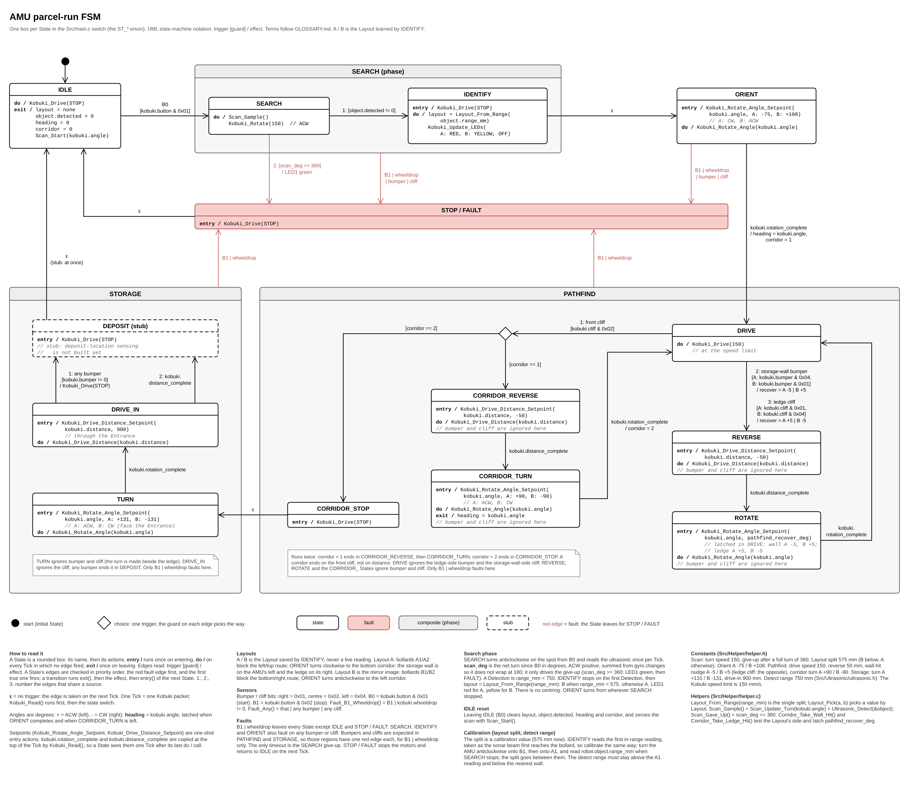

# MicroControllingProject

Firmware for the Autonomous Mobile Unit (AMU): a Kobuki base driven by a NUCLEO-G474RE that finds the test-area Layout, drives the open route past the storage wall and the ledge, and delivers a parcel into the storage unit.

- Hiten
- Safin
- Shaheer M

## How it runs

One control step per received Kobuki packet (`Kobuki_Read()`, then a `switch` on the current state in `Src/main.c`). The AMU walks this path:

```
IDLE ──B0──▶ SEARCH ─▶ IDENTIFY ─▶ ORIENT ──▶ PATHFIND ──▶ STORAGE ──▶ IDLE

PATHFIND = Drive, Reverse, Rotate, Corridor turn / reverse / stop
STORAGE  = Turn, Drive-in, Deposit, Deposit align, Deposit refine turn / sample,
           Deposit distance / reverse / approach

Any State except IDLE ──B1 / wheeldrop──▶ STOP / FAULT ──▶ IDLE
```



Pathfind recovery is **Drive → Reverse (−50 mm) → Rotate (wall hit: A −5° / B +5°, ledge cliff: the opposite) → Drive**. There is no Realign, Wall hit, or Ledge hit state.

### Deposit

After Drive-in the AMU turns anticlockwise through a full 360° at 50 mm/s wheel speed and records the closest valid ultrasonic target and its gyro heading. It then turns by the shortest route to face that saved heading, finishing within 1°, and refines the heading with a local scan (below). Once it faces the refined heading it adjusts the ultrasonic reading to the target range (`DEPOSIT_TARGET_RANGE_MM`, currently **410 mm**, ±`DEPOSIT_RANGE_TOLERANCE_MM`, currently **10 mm**) before stopping in Idle. A full-circle scan with no valid echo stops in Idle with LED 1 red.

The local scan covers **±25°** around the coarse heading in **2° steps** at 35 mm/s wheel speed. At each step the AMU stops for about 300 ms, then takes three readings spaced about 100 ms apart and keeps their median, so one bad echo cannot choose the heading. It chooses the centre of the widest contiguous group of steps within 10 mm of the local minimum, so a flat response across the ultrasonic beam aims at its middle. Separate echoes are kept apart, and equal-width groups prefer the one nearest the coarse heading. It then returns to this refined heading, stopping when the gyro error is within 0.5°. If the local scan finds no valid echo, it stops through Fault with LED 1 red, without driving forward or backward. Physical accuracy still depends on the beam, gyro and sensor calibration. The scan width, step size, sampling times and speeds are tunables in `Src/Helper/helper.h`.

If the reading is below the tolerance band, the AMU reverses at 50 mm/s until it reads at least the target plus `DEPOSIT_REVERSE_MARGIN_MM` (100 mm), then approaches at 35 mm/s so the final correction is always made moving forward. If it starts beyond the band, it approaches directly. It pauses for about 300 ms after alignment and after each stop so the 10 Hz ultrasonic output catches up, then checks the distance again; a reading still below the band repeats the reverse-then-approach correction. The target, tolerance, extra reverse distance and speeds are tunables in `Src/Helper/helper.h`.

LED 1 is yellow during distance adjustment, green when the settled reading is within tolerance, and red for a missing or invalid echo. A zero or maximum-range reading stops distance adjustment through Fault. B1 or wheeldrop stops any part of Deposit, and bumpers and cliffs also stop the distance states.

Inspect `robot.deposit_rod.detected`, `robot.deposit_rod.range_mm` and `robot.deposit_rod_angle` in the debugger for the scan result, and `robot.deposit_range_mm` for the live distance. The angle is the absolute Kobuki gyro heading in 0.01° ticks, wrapping at ±18000. All target distances are from the ultrasonic sensor face to the rod.

To bench-test Deposit on its own, build with `DEPOSIT_TEST_MODE` set to **1** (it is **0** by default, which keeps the full parcel run). The AMU then enters Deposit automatically after the first Kobuki feedback packet, and B0 from Idle repeats the sequence instead of starting Search.

## Docs

| Doc | What it is |
| --- | --- |
| [`GLOSSARY.md`](GLOSSARY.md) | Shared vocabulary for the FSM, report, and code |
| [`docs/pathfind.md`](docs/pathfind.md) | Pathfind states and how Drive / Reverse / Rotate work |
| [`docs/amu_fsm.drawio`](docs/amu_fsm.drawio) | Full AMU FSM diagram (edit in diagrams.net) |
| [`docs/amu_fsm_preview.png`](docs/amu_fsm_preview.png) | PNG preview of that diagram (export at 200 % after editing the `.drawio`) |
| [`sim/README.md`](sim/README.md) | PC simulator that runs this firmware against a simulated Kobuki, ultrasonic sensor and arena |

## Source layout

| Path | What is in it |
| --- | --- |
| `Src/main.c` | Init, the Read loop, and the state `switch` |
| `Src/Helper/` | Shared `robot` data, tunables, fault checks, scan and Pathfind helpers |
| `Src/Kobuki_Drivers/` | Kobuki packet read / write, distance and angle setpoints |
| `Src/Ultrasonic/`, `Src/ADC/`, `Src/G474RE_Drivers/` | Ultrasonic reading, ADC and UART drivers |

## Build

```
cmake --preset Debug      # or Release
cmake --build --preset Debug
```

Needs `cmake`, `ninja` and the `arm-none-eabi` GCC toolchain. The ELF is `build/<preset>/main.elf`. CI builds both presets and checks formatting (`scripts/format.sh --check`, clang-format 18.1.8) and cppcheck.

`make -C sim check-deposit` runs the firmware loop against mocked gyro, motion and delayed ultrasonic readings. It covers local alignment across the gyro wrap, median filtering and beam centring, a lost rod, starting too close, too far or within tolerance, reverse-then-approach correction, sensor noise, and movement stops. It needs Python 3 and a host GCC compiler; it does not use the arena simulator's memory mapping.
