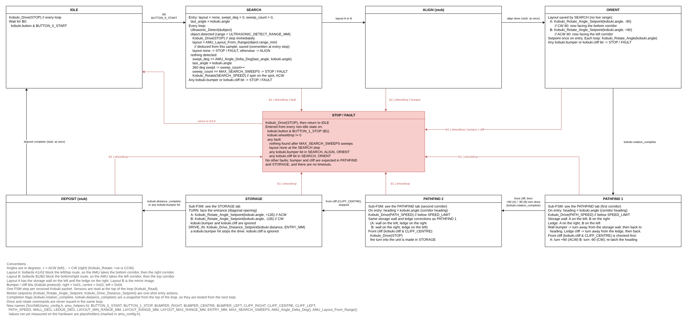

# MicroControllingProject

Firmware for the Autonomous Mobile Unit (AMU): a Kobuki base driven by a NUCLEO-G474RE that finds the test-area Layout, drives the open route past the storage wall and the ledge, and delivers a parcel into the storage unit.

- Hiten
- Safin
- Shaheer M

## How it runs

One control step per received Kobuki packet (`Kobuki_Read()`, then a `switch` on the current state in `Src/main.c`). The AMU walks this path:

```
IDLE ──B0──▶ SEARCH ⇄ DETECT / SPIN ──▶ ALIGN ──▶ ORIENT ──▶ PATHFIND ──▶ STORAGE ──▶ IDLE
                                                       (Drive, Reverse, Rotate,     (Turn, Drive-in,
                                                        Corridor turn / stop)        Deposit)

Any State except IDLE ──B1 / wheeldrop──▶ STOP / FAULT ──▶ IDLE
```



Pathfind recovery is **Drive → Reverse (−50 mm) → Rotate (A +10° / B −10°) → Drive**. There is no Realign, Wall hit, or Ledge hit state.

## Docs

| Doc | What it is |
| --- | --- |
| [`GLOSSARY.md`](GLOSSARY.md) | Shared vocabulary for the FSM, report, and code |
| [`docs/pathfind.md`](docs/pathfind.md) | Pathfind states and how Drive / Reverse / Rotate work |
| [`docs/amu_fsm.drawio`](docs/amu_fsm.drawio) | Full AMU FSM diagram (edit in diagrams.net) |
| [`docs/amu_fsm_preview.png`](docs/amu_fsm_preview.png) | PNG preview of that diagram (export at 200 % after editing the `.drawio`) |
| [`sim/README.md`](sim/README.md) | PC simulator that runs this firmware against a simulated Kobuki, ultrasonic sensor and arena |

## Source layout

| Path | What is in it |
| --- | --- |
| `Src/main.c` | Init, the Read loop, and the state `switch` |
| `Src/Helper/` | Shared `robot` data, tunables, `Layout_From_Range()` |
| `Src/Kobuki_Drivers/` | Kobuki packet read / write, distance and angle setpoints |
| `Src/Ultrasonic/`, `Src/ADC/`, `Src/G474RE_Drivers/` | Ultrasonic reading, ADC and UART drivers |

## Build

```
cmake --preset Debug      # or Release
cmake --build --preset Debug
```

Needs `cmake`, `ninja` and the `arm-none-eabi` GCC toolchain. The ELF is `build/<preset>/main.elf`. CI builds both presets and checks formatting (`scripts/format.sh --check`, clang-format 18.1.8) and cppcheck.
