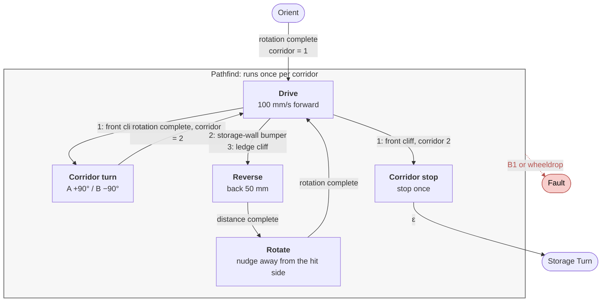

# Pathfind

How the AMU drives the two corridors while staying clear of the storage wall and the ledge. Terms match [`GLOSSARY.md`](../GLOSSARY.md). The full diagram is [`amu_fsm.drawio`](amu_fsm.drawio) (preview: [`amu_fsm_preview.png`](amu_fsm_preview.png)).

Pathfind runs once per corridor (`corridor = 1`, then `corridor = 2` after Corridor turn). With Orient A = −90° / B = +90°, Layout A has the storage wall on the left and the ledge on the right; Layout B is the mirror image.

## States

| State | Role |
| --- | --- |
| **Drive** | Drive forward along the corridor heading |
| **Reverse** | Back a fixed distance after a wall bumper or ledge cliff |
| **Rotate** | Turn `pathfind_recover_deg` after Reverse, away from the side that was hit |
| **Corridor turn** | End of corridor 1: 90° onto corridor 2, latch new heading |
| **Corridor stop** | End of corridor 2: stop, then leave Pathfind into Storage Turn |

There are no Wall hit, Ledge hit, or Realign states. Wall and ledge events both enter **Reverse**.

## Check order

Each Pathfind case in `Src/main.c` checks conditions in priority order and takes at most one transition per Kobuki packet. **B1 or wheeldrop → Fault** is first in every Pathfind state.

| State | Checks, in order |
| --- | --- |
| Drive | fault → front cliff (corridor 1) → front cliff (corridor 2) → storage-wall bumper → ledge cliff → drive forward |
| Reverse | fault → distance complete → reverse |
| Rotate | fault → rotation complete → rotate |
| Corridor turn | fault → rotation complete → rotate |
| Corridor stop | fault → ε to Storage Turn |

## Drive

- **Do:** `Kobuki_Drive(PATHFIND_DRIVE_SPEED)` (100 mm/s).
- **Front cliff:** centre sensor (`0x02`) via `Kobuki_IsCliffDetected(&robot.kobuki, SIDE_CENTRE)`. It ends the corridor: corridor 1 goes to Corridor turn, corridor 2 to Corridor stop. No reverse after a front cliff.
- **Storage-wall bumper:** Layout A left (`0x04`), Layout B right (`0x01`). Ledge-side bumper is ignored.
- **Ledge cliff:** Layout A right (`0x01`), Layout B left (`0x04`). Storage-wall-side cliff is ignored.
- **Ignored in Drive:** ledge-side bumper, storage-wall-side cliff, centre bumper.
- On either hit, Drive latches `pathfind_recover_deg` before Reverse: wall uses `PATHFIND_ROTATE_*` (away from the storage wall); ledge uses the negation (away from the ledge).

## Reverse

Entered from Drive when the storage-wall bumper or ledge cliff fires.

- **Entry:** distance setpoint `−PATHFIND_REVERSE_MM` (−50 mm).
- **Do:** `Kobuki_Drive_Distance` until `distance_complete`.
- **Then:** always enter **Rotate**.
- **Sensors:** bumper and cliff are ignored here. Only B1 or wheeldrop → Fault.

## Rotate

Entered from Reverse when the back-off finishes.

- **Entry:** `robot.pathfind_recover_deg`, latched when Drive entered Reverse. Wall hits use `PATHFIND_ROTATE_A_DEG` (−10) or `PATHFIND_ROTATE_B_DEG` (+10); ledge hits use the negation. Does not use `robot.heading`.
- **Do:** `Kobuki_Rotate_Angle` until `rotation_complete`.
- **Then:** return to **Drive**. There is no matching +50 mm forward resume after Rotate.
- **Sensors:** same as Reverse: bumper and cliff are ignored; B1 or wheeldrop → Fault.

If Drive still sees the wall bumper or ledge cliff on the next packet after Rotate, it enters Reverse again (no “sensors must be clear” gate).

## Corridor turn / stop

- **Turn (corridor 1):** Layout A +90° (anticlockwise), Layout B −90° (clockwise). On leaving it latches `heading`, and sets `corridor = 2`.
- **Stop (corridor 2):** stop once on entry, then straight into Storage Turn on the next packet.

## Constants

| Macro | Value | Used by |
| --- | --- | --- |
| `PATHFIND_DRIVE_SPEED` | 100 | Drive |
| `PATHFIND_REVERSE_MM` | 50 | Reverse |
| `PATHFIND_ROTATE_A_DEG` / `_B_DEG` | −10 / +10 | Drive latches into `pathfind_recover_deg` (wall); ledge uses the negation |
| `PATHFIND_CORNER_A_DEG` / `_B_DEG` | +90 / −90 | Corridor turn |

Angles are in degrees, + = anticlockwise (`Kobuki_Rotate`: +ve is CCW). All values are tunable in `Src/Helper/helper.h`.

## Faults

One red edge for the whole Pathfind region: **B1 or wheeldrop → Fault**. No other Pathfind-specific faults. Fault stops the motors and returns to Idle on the next packet.

## Code

Pathfind lives in the `ST_PATHFIND_*` cases of `Src/main.c`. Tunables and `robot` fields are in `Src/Helper/helper.h`. Entry setpoints run in `change_to()` for that state.
