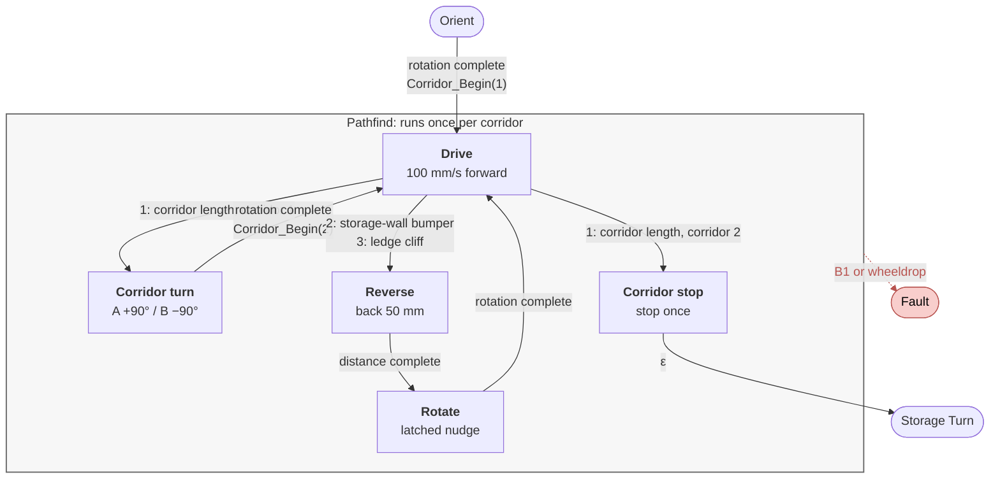

# Pathfind

How the AMU drives the two corridors for a fixed left-wheel distance, backs off the storage wall, and recovers from a ledge cliff. Terms match [`GLOSSARY.md`](../GLOSSARY.md). The full diagram is [`amu_fsm.drawio`](amu_fsm.drawio) (preview: [`amu_fsm_preview.png`](amu_fsm_preview.png)).

Pathfind runs once per corridor. Orient completion calls `Corridor_Begin(1)`. Corridor turn completion calls `Corridor_Begin(2)`. With Orient A = −90° / B = +90°, Layout A has the storage wall on the left and the ledge on the right; Layout B is the mirror image. Corridors end on left-wheel distance, not on the front cliff.

## States

| State | Role |
| --- | --- |
| **Drive** | Drive forward until the corridor length |
| **Reverse** | Back a fixed distance after a storage-wall bumper or ledge cliff |
| **Rotate** | Turn `pathfind_recover_deg` after Reverse |
| **Corridor turn** | End of corridor 1: 90° onto corridor 2, latch new heading |
| **Corridor stop** | End of corridor 2: stop, then leave Pathfind into Storage Turn |

There are no Wall hit, Ledge hit, or Realign states. Wall bumper and ledge cliff both enter **Reverse**.

## Check order

Each Pathfind case in `Src/main.c` checks conditions in priority order and takes at most one transition per Kobuki packet. **B1 or wheeldrop → Fault** is first in every Pathfind state.

| State | Checks, in order |
| --- | --- |
| Drive | fault → corridor length (corridor 1) → corridor length (corridor 2) → storage-wall bumper → ledge cliff → drive forward |
| Reverse | fault → distance complete → reverse |
| Rotate | fault → rotation complete → rotate |
| Corridor turn | fault → rotation complete → rotate |
| Corridor stop | fault → ε to Storage Turn |

## Drive

- **Do:** `Kobuki_Drive(PATHFIND_DRIVE_SPEED)` (100 mm/s).
- **Corridor length:** `Kobuki_Distance_Delta_Mm` from `corridor_start_distance` is at least `Corridor_Length_Mm()`. Corridor 1 goes to Corridor turn. Corridor 2 goes to Corridor stop. The same comparison is used for both corridors.
- **Storage-wall bumper:** `Corridor_Wall_Hit`. Layout A left (`0x04`), Layout B right (`0x01`). It latches `pathfind_recover_deg` to `PATHFIND_ROTATE_A_DEG` or `PATHFIND_ROTATE_B_DEG` and enters Reverse. Ledge-side bumper is ignored.
- **Ledge cliff:** `Corridor_Ledge_Hit`. Layout A right (`0x01`), Layout B left (`0x04`). It latches the opposite nudge and enters Reverse. The front centre cliff does not end a corridor and does not enter Reverse.

## Reverse

Entered from Drive when the storage-wall bumper or ledge cliff fires.

- **Entry:** distance setpoint `−PATHFIND_REVERSE_MM` (−50 mm).
- **Do:** `Kobuki_Drive_Distance` until `distance_complete`.
- **Then:** always enter **Rotate**.
- **Sensors:** bumper and cliff are ignored here. Only B1 or wheeldrop → Fault.

## Rotate

Entered from Reverse when the back-off finishes.

- **Entry:** `robot.pathfind_recover_deg`, latched when Drive entered Reverse. Does not use `robot.heading`.
- **Do:** `Kobuki_Rotate_Angle` until `rotation_complete`.
- **Then:** return to **Drive**. That return does not call `Corridor_Begin`, so the corridor length keeps the original start tick. There is no matching +50 mm forward resume after Rotate.
- **Sensors:** same as Reverse. Bumper and cliff are ignored. B1 or wheeldrop → Fault.

If Drive still sees the wall bumper or ledge cliff on the next packet after Rotate, it enters Reverse again (no “sensors must be clear” gate).

## Corridor turn / stop

- **Turn (corridor 1):** Layout A +90° (anticlockwise), Layout B −90° (clockwise). On leaving it latches `heading` and calls `Corridor_Begin(2)`.
- **Stop (corridor 2):** stop once on entry, then straight into Storage Turn on the next packet.

## Constants

| Macro | Value | Used by |
| --- | --- | --- |
| `PATHFIND_DRIVE_SPEED` | 100 | Drive |
| `PATHFIND_REVERSE_MM` | 50 | Reverse |
| `PATHFIND_ROTATE_A_DEG` / `_B_DEG` | −10 / +10 | wall hit latches into `pathfind_recover_deg` |
| `PATHFIND_CORNER_A_DEG` / `_B_DEG` | +90 / −90 | Corridor turn |
| `PATHFIND_CORRIDOR_1_A_MM` / `_2_A_MM` | 1200 / 1400 | Corridor length, Layout A |
| `PATHFIND_CORRIDOR_1_B_MM` / `_2_B_MM` | 1400 / 1200 | Corridor length, Layout B |

Angles are in degrees, + = anticlockwise (`Kobuki_Rotate`: +ve is CCW). All values are tunable in `Src/Helper/helper.h`.

## Faults

One red edge for the whole Pathfind region: **B1 or wheeldrop → Fault**. No other Pathfind-specific faults. Fault stops the motors and returns to Idle on the next packet.

## Code

Pathfind lives in the `ST_PATHFIND_*` cases of `Src/main.c`. Tunables and `robot` fields are in `Src/Helper/helper.h`. Entry setpoints run in `change_to()` for that state.
